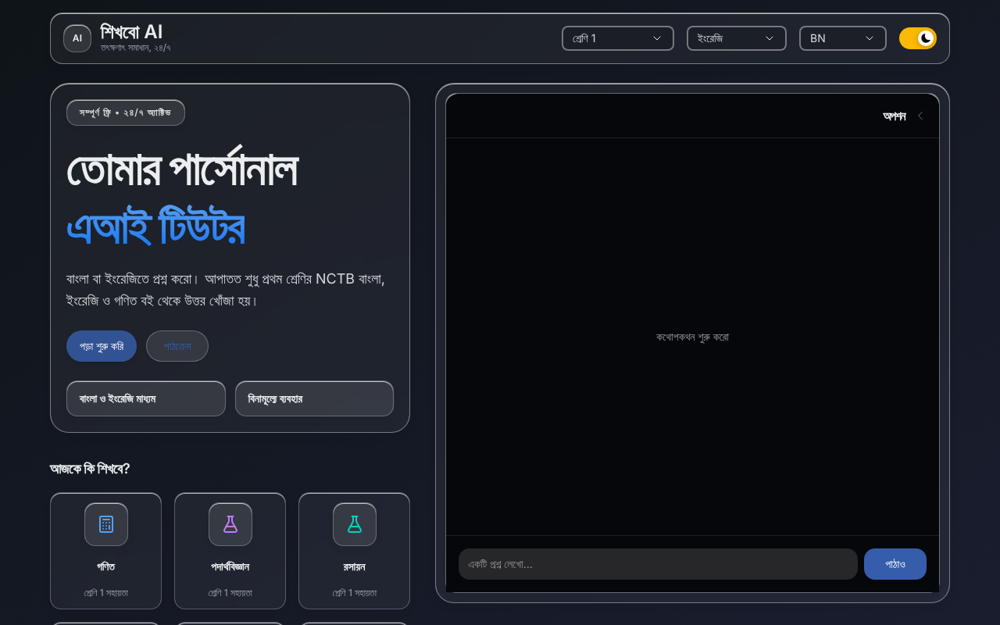
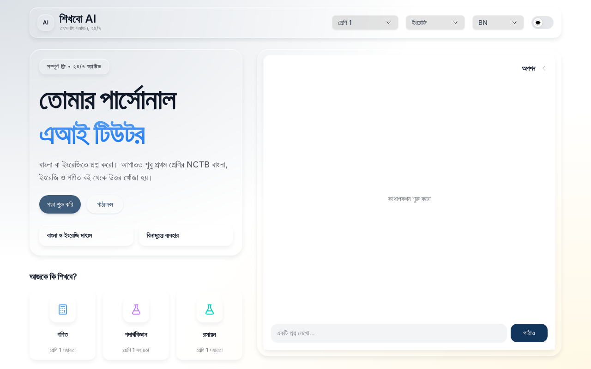
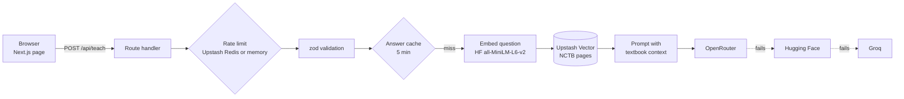

# Shikhbo AI

A homework tutor for students in Bangladesh that explains answers step by step, using pages from their NCTB textbooks when it can.

[](https://github.com/tahmidbintaslim/Shikhbo-AI/actions/workflows/ci.yml)
[](LICENSE)


**Status: prototype, no working live demo.** Textbook lookup covers four NCTB Class 1 books. The old Vercel deployment is not linked here because its API fails; [Status](#status) explains why and what is left to fix it.

| Dark theme (default) | Light theme |
| --- | --- |
|  |  |

Screenshots from a local production build (`npm run build && npm start`), 1280 x 800.

## Features

- Ask a question in a chat box. Pick the class (1 to 12) and the medium (Bangla or English). The page, chat box included, switches between Bangla (the default) and English.
- Textbook lookup (RAG): the question is matched against OCR'd pages of NCTB textbooks in Upstash Vector, filtered by class and medium, and the best pages go to the model as context.
- Three chat providers tried in order (OpenRouter, Hugging Face Inference Providers, Groq), so one provider being down or out of free quota does not stop answers.
- Answers render as Markdown (headings, numbered and bulleted lists, code) with KaTeX math. The conversation stays in the browser and can be exported as a text file.
- Per-IP rate limit (Upstash Redis, or in memory for local work) and a 5-minute answer cache.
- Clear failures: with no provider key the API answers `503` with `code: "not_configured"` and the chat says the tutor is not set up; a Redis or vector URL that is not an `https://` REST URL disables that one service (and `/api/health` reports it) and logs which variable to fix.
- `GET /api/health` reports whether the deployment has a chat provider and textbook lookup (counts and booleans only).

## How it works



The app is a single Next.js 16 page plus `POST /api/teach` and `GET /api/health`.

1. **Rate limit.** 10 requests per minute per client IP, keyed on the first `X-Forwarded-For` hop. Vercel sets that header itself; behind a proxy that passes a client's own `X-Forwarded-For` through, a client can pick its key and get around the limit. It uses Upstash Redis when its credentials are set; otherwise an in-memory counter, which only works on a single long-running server.
2. **Configuration check.** If no chat provider key is set, the route stops here with `503 not_configured`.
3. **Validation.** A zod schema accepts `user` and `assistant` turns only, keeps the last 10, requires an integer class from 1 to 12 and a medium of `english` or `bengali`, and caps lengths. HTML tags are stripped from questions.
4. **Answer cache.** An exact-match cache for 5 minutes, keyed on class, medium and a SHA-256 hash of the latest question. It uses Redis through `KV_REST_API_*` when set, otherwise server memory.
5. **Retrieval.** The question is embedded with `sentence-transformers/all-MiniLM-L6-v2` on Hugging Face and matched against Upstash Vector (top 5 pages, filtered by class and medium). If the embedding call or the vector query fails, or takes more than 5 seconds, the tutor answers without textbook context instead of failing.
6. **Generation.** Providers are tried in order: OpenRouter, Hugging Face Inference Providers, Groq. The first non-empty answer wins. `<think>...</think>` reasoning blocks are removed before the answer is returned. If every provider fails, the route answers `503 providers_unavailable`.

Every error body has the shape `{ "error": "...", "code": "..." }`. The codes are `rate_limited` (429), `not_configured` (503), `too_large` (413), `invalid_input` (400), `providers_unavailable` (503) and `internal_error` (500). The chat shows its own Bangla or English message for `rate_limited`, `not_configured` and `providers_unavailable`, and a generic error message for the rest.

## Tech stack

Next.js 16 (App Router, Turbopack), React 19, TypeScript, HeroUI, Tailwind CSS 4, Framer Motion, Vercel AI SDK with the OpenRouter and Groq providers, `@huggingface/inference`, Upstash Vector, Upstash Redis and Ratelimit, `@vercel/kv`, zod, react-markdown with KaTeX, tesseract.js and Ghostscript for ingestion, Bun for unit tests and Playwright for smoke tests.

## Getting started

Prerequisites:

- Node.js 22 (`engines` in `package.json`; CI and Vercel use 22) and npm 10
- [Bun](https://bun.sh/) 1.4 or later, for the unit tests
- Optional: [Ghostscript](https://www.ghostscript.com/) to ingest textbooks

```bash
git clone https://github.com/tahmidbintaslim/Shikhbo-AI.git
cd Shikhbo-AI
npm ci
cp .env.example .env.local   # then fill in the keys you have
npm run dev                  # http://localhost:3000
```

With no chat provider key set, the page loads and every question gets the "not set up" message (`503 not_configured`). With a provider key but no Upstash Vector index, the tutor answers without textbook context. `curl http://localhost:3000/api/health` shows which of the two you have.

Checks, in the order CI runs them:

```bash
npm run lint
npm run typecheck
npm test                         # unit tests (bun test, files in __tests__/)
npm run build
npx playwright install chromium  # once per machine
npm run test:e2e                 # smoke tests against the production build
```

`npm run test:e2e` starts `next start` on port 3100 itself. It passes with or without provider keys: the tests read `/api/health` and check the behaviour that matches.

`next-env.d.ts` is generated by `next dev`, `next build` and `npm run typecheck` (through `next typegen`), so it is gitignored, as the Next.js docs advise. `AGENTS.md` is the instruction block `next dev` writes for AI coding agents; it is committed so running the dev server leaves the working tree clean.

## Environment variables

Set these in `.env.local` for local work, or in your host's settings. `.env.example` lists them all. Values are trimmed, so a key pasted with a trailing newline still works.

| Name | Needed for | Notes |
| --- | --- | --- |
| `OPENROUTER_API_KEY` | Chat, first provider | Set at least one of the three chat keys |
| `HF_API_KEY` | Chat, second provider; question embeddings | Required for textbook retrieval |
| `GROQ_API_KEY` | Chat, third provider | |
| `OPENROUTER_MODEL` | Optional | Default `google/gemma-4-31b-it:free` |
| `HF_CHAT_MODEL` | Optional | Default `google/gemma-4-26B-A4B-it` |
| `GROQ_MODEL` | Optional | Default `openai/gpt-oss-120b` |
| `HF_EMBEDDING_MODEL` | Optional | Default `sentence-transformers/all-MiniLM-L6-v2`. Must match the model the index was built with |
| `UPSTASH_VECTOR_REST_URL` | Textbook retrieval | An `https://` REST URL with no user name or password; anything else turns retrieval off |
| `UPSTASH_VECTOR_REST_TOKEN` | Textbook retrieval | |
| `UPSTASH_REDIS_REST_URL` | Shared rate limit | Use this pair or the `KV_REST_API_*` pair. An `https://` REST URL, not `redis://` |
| `UPSTASH_REDIS_REST_TOKEN` | Shared rate limit | |
| `KV_REST_API_URL` | Shared rate limit and answer cache | Set by the Vercel marketplace Upstash integration |
| `KV_REST_API_TOKEN` | Shared rate limit and answer cache | |
| `NEXT_PUBLIC_APP_URL` | Optional | Base URL for `sitemap.xml` and `robots.txt` |
| `GOOGLE_SITE_VERIFICATION` | Optional | Search Console verification tag |

The default model IDs were checked against each provider's model list on 2026-10-19.

## Textbook ingestion

The textbooks are not stored in this repository. `books/sources.json` lists each file with its NCTB download link, a mirror, and a SHA-256 checksum.

1. Create an Upstash Vector index with dimension 384 (the output size of `all-MiniLM-L6-v2`) and the cosine metric.
2. Install Ghostscript so the `gs` command is on your `PATH`. The script uses it to turn PDF pages into images.
3. Put `HF_API_KEY`, `UPSTASH_VECTOR_REST_URL` and `UPSTASH_VECTOR_REST_TOKEN` in `.env.local`.
4. Download the books and check their hashes:

   ```bash
   npm run books:fetch
   ```

5. Run the ingest script from the repository root:

   ```bash
   npx tsx scripts/ingest.ts
   ```

The script OCRs every page with Tesseract (`ben` for `books/bengali/`, `eng` for `books/english/`), skips near-empty pages, embeds each page and upserts it with `text`, `source`, `language`, `grade` and `page` metadata. The class comes from the file name ("Class 1") and the medium from the folder. tesseract.js downloads its language data on the first run. OCR runs one page at a time, so a full run is slow.

## Scripts

| Command | What it does |
| --- | --- |
| `npm run dev` | Development server |
| `npm run build` | Production build |
| `npm start` | Serve the production build |
| `npm run lint` | ESLint |
| `npm run typecheck` | `next typegen`, then `tsc --noEmit` |
| `npm test` | Unit tests (`bun test`, files in `__tests__/`) |
| `npm run test:e2e` | Playwright smoke tests in `e2e/` (run `npm run build` first) |
| `npm run books:fetch` | Download the NCTB textbooks listed in `books/sources.json` (add `-- --ocr` to also fetch the Tesseract data) |

CI (`.github/workflows/ci.yml`) runs install, lint, typecheck, unit tests, build and the Playwright smoke tests on pushes and pull requests to `main`. Dependabot (`.github/dependabot.yml`) opens grouped npm and GitHub Actions updates weekly.

## Deployment

The project is set up for Vercel. `vercel.json` sets the framework, `npm ci` as the install command and the `sin1` (Singapore) region, the closest one to Bangladesh. `package.json` pins Node.js 22. To deploy your own copy: import the repository in Vercel, add the environment variables above, deploy, then check `https://<your-deployment>/api/health`. It returns `200` with `"ok": true` once a chat provider key is set.

Other hosts that run a Next.js Node server should work too, but only Vercel has been used. A static export does not work, because the tutor is an API route.

## Project layout

```
src/
  app/page.tsx                 Landing page and chat layout
  app/api/teach/route.ts       The tutor API
  app/api/health/route.ts      Configuration status
  components/ChatProvider.tsx  One chat state shared by the header pickers, subject cards and chat box
  components/ChatInterface.tsx Chat box
  hooks/useChat.ts             Chat state and the request to /api/teach
  lib/config.ts                Which services the env vars enable; safe client setup
  lib/chat-errors.ts           Error code to chat message
  lib/teach.ts                 Request schema, sanitizing, cache key, helpers
  lib/teach-limits.ts          Length and history limits shared by client and server
  lib/retrieval.ts             Embedding plus vector search with timeout and fallback
  lib/rate-limit.ts            Upstash rate limit with in-memory fallback
  lib/models.ts                Model IDs and their env overrides
  data/landing-content.ts      Landing page copy (Bangla and English)
scripts/
  ingest.ts                    OCR, embed and index the textbooks
  fetch-books.mjs              Download the textbooks listed in books/sources.json
books/sources.json             Textbook sources and checksums
__tests__/                     Unit tests (bun)
e2e/                           Smoke tests (Playwright)
docs/images/                   README screenshots
```

## Status

This is a prototype, not a product in use.

**Live demo.** The Vercel project still serves a build from 2026-01-30. In that build, a failure in the retrieval step (question embedding or vector query) is not caught, so `POST /api/teach` answers HTTP 500 to every question (checked 2026-10-25). Current `main` answers without textbook context when retrieval fails, and reports missing or malformed settings with a `503` and a clear message instead of a 500. That code has not reached production: every Vercel deployment since 2026-07-23 has failed about one second after it started, before the build step. The same commits pass CI and build with `vercel build` locally, so the cause is in the Vercel project or account settings and is visible only in its deployment logs. Once a deployment succeeds and `/api/health` reports `"ok": true`, the demo link goes back at the top of this file.

**Roadmap**, in order:

1. Get a working deployment (see above) with at least one chat provider key.
2. Index more textbooks than the four Class 1 books, starting with the classes the picker offers.
3. Use a multilingual embedding model and chunk pages, so Bangla questions find the right page.
4. Stream answers, and add content moderation before students use it.

## Limitations

- Only four Class 1 textbooks are indexed (see `books/sources.json`). The class picker goes up to 12 and the subject cards include Physics, Chemistry and ICT, but there is no textbook data for them.
- Bangla retrieval is weak. The embedding model is English-only, and each OCR'd page is embedded as one chunk, so long pages are truncated.
- The cache key covers only the latest question. A short follow-up such as "explain more" can get an answer cached from another conversation within 5 minutes.
- Answers arrive in one piece (no streaming), and nothing checks them. The model can be wrong, and there is no content moderation.
- There is no sign-in. The rate limit is the only protection against someone using up your provider credits.
- Free-tier models change and get retired. Model IDs are read from environment variables so you can switch without a code change.
- The "Start learning" and "Syllabus" buttons do nothing yet.

## Privacy

This app is aimed at children, so be clear about where a question goes:

- **Model providers.** The question and the earlier turns of the conversation (up to 10 messages in all) go to the chat providers you configure: OpenRouter (and the model host it routes to), Hugging Face Inference Providers, and Groq. The question also goes to Hugging Face to be embedded. Each provider's own terms apply, and free tiers may log prompts. Read them before you deploy this for students.
- **Upstash Vector** receives the question's embedding (a list of numbers), not the text.
- **Answer cache.** The answer text is stored for 5 minutes in Redis. Without Redis it is kept in server memory, where an expired answer is only removed when the same question comes in again or the server restarts. The key holds the class, the medium and a hash of the question, not the question itself.
- **Rate limit.** A hash of the client IP is the rate-limit key. Upstash Redis keeps it for about two minutes. The in-memory fallback keeps it until the server restarts, or until more than 10,000 keys are stored and expired ones are cleared.
- **Logs.** The server does not log questions or answers. Failures log one short line with the provider, the error type and the error message, with URLs and long token-like strings replaced by `<url>` and `<redacted>`. Configuration problems log the variable name, never its value. Your host may keep its own request logs.
- **Browser.** The conversation stays in `localStorage` until the student clears it.
- There are no analytics or tracking scripts in the app.

Tell students not to type personal details into the chat.

## Contributing

Issues and pull requests are welcome at https://github.com/tahmidbintaslim/Shikhbo-AI. Before opening a pull request, run the checks under [Getting started](#getting-started); CI runs the same ones. Keep secrets out of commits: `.env.local` is ignored, and `.env.example` holds names only.

## License

The code is licensed under CC BY-NC-SA 4.0; see [LICENSE](LICENSE). The textbooks are published by the National Curriculum and Textbook Board (NCTB), Government of Bangladesh, are not part of this repository, and are not covered by its license.
